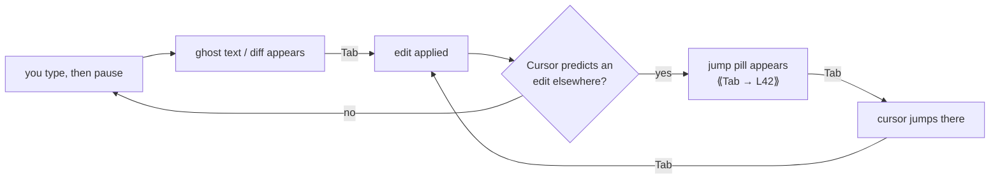
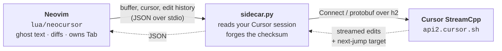

<h1 align="center">neocursor.nvim</h1>

<p align="center">
  <b>Cursor's Tab — the real next-edit model — inside Neovim.</b>
</p>

<p align="center">
  <a href="https://github.com/teocns/neocursor.nvim/actions/workflows/ci.yml">
    </a>
  <a href="https://github.com/teocns/neocursor.nvim/releases/latest">
    </a>
  
  
  <a href="./LICENSE">
    </a>
</p>

<p align="center">
  
</p>

<p align="center">
  <sub>Renamed one field on line 3. The two call sites below are now stale.
  <code>&lt;Tab&gt;</code> jumps to each one · <code>&lt;Tab&gt;</code> again accepts the rewrite.</sub>
</p>

No API key. No model to choose. No account to create. If you're already signed
into Cursor, there is nothing else to set up — neocursor drives Cursor's own
`StreamCpp` backend with your existing login. Prediction quality and latency
also depend on the client’s context collection and request handling; identical
results are not guaranteed.

> [!WARNING]
> **Beta.** The goal is a smooth Cursor-like Tab workflow in Neovim.
> See [Cursor Tab parity](#cursor-tab-parity) for the honest scoreboard.

<p align="center">
  <a href="#requirements">Requirements</a> ·
  <a href="#installation">Installation</a> ·
  <a href="#usage">Usage</a> ·
  <a href="#configuration">Configuration</a> ·
  <a href="#cursor-tab-parity">Parity</a> ·
  <a href="#how-it-works">How it works</a> ·
  <a href="#troubleshooting">Troubleshooting</a>
</p>

---

## Requirements

- **Neovim ≥ 0.10**
- **Cursor, installed and signed in** (the desktop app) — neocursor reads your
  existing session. No token to paste, no API key, no separate subscription.
- **[`uv`](https://github.com/astral-sh/uv)** on your `PATH` — the Python sidecar
  runs through it and fetches its own deps. Nothing to `pip install`.

Works on **macOS, Linux and Windows**; the sidecar finds Cursor's session
wherever your platform puts it. Portable install, Flatpak/Snap, or WSL? See
[Cursor can't be found](./docs/troubleshooting.md#cursor-cant-be-found).

---

## Installation

### lazy.nvim

```lua
{
  "teocns/neocursor.nvim",
  event = "InsertEnter",
  -- pre-warm the sidecar (double quotes so cmd.exe and sh both parse it)
  build = 'uv run --with "httpx[http2]" python -c "import httpx"',
  opts = {},
}
```

That's the entire setup. No tokens, no required `setup()` arguments — open a
file, start typing, pause → ghost text → `<Tab>`.

### vim.pack

Built into Neovim ≥ 0.12:

```lua
vim.pack.add { "https://github.com/teocns/neocursor.nvim" }
require("neocursor").setup {}
```

**More setups** → [docs/installation.md](./docs/installation.md): full vim.pack
parity with the lazy.nvim spec, coexisting with nvim-cmp / blink.cmp, and
pinning a version.

---

## Usage

Type, pause, and a suggestion appears. Then:

| Key / Command | Does |
|---|---|
| `<Tab>` | Accept · or **jump** to the predicted next edit · or chain to the next one |
| `<M-Right>` | Accept the suggestion word-by-word |
| `<Esc>` | Dismiss — leaving insert mode discards the suggestion and tells the model no |
| `<C-]>` | Dismiss **without leaving insert**, for when you want to keep typing |
| `:NeocursorSuggest` | Force a request right now |
| `:NeocursorLog` | Toggle the live state dashboard |
| `:NeocursorDebug` | Print diagnostics |

### The tab-tab-tab flow

One key accepts an edit, jumps to the next destination, and accepts again:



Completed edits appear as soon as they arrive. Compatible typing keeps the
remaining preview visible, including rewrites and insertions before punctuation.
The plugin prepares one predicted destination in the background. If you jump
before its edit is ready, Tab is consumed for up to one second while loading;
it never accepts an unseen edit. Press Tab again after the preview appears.

The loop back through *jump → accept* is what makes it feel like Cursor rather
than a completion engine: you keep pressing the same key and the edits come to
you.

### Saying no

`<Esc>` is the dismiss key, and it needs no mapping — neocursor never touches
`<Esc>`, so your macros, your snippet plugin and your IME switcher all keep it.
Leaving insert mode already discards the suggestion; what neocursor adds is that
it *counts*, so the same rejected edit isn't offered straight back. This is also
exactly what Cursor does under a vim layer: its Escape handler dismisses the
suggestion and lets the keypress through, so the mode change happens too.

By default, suggestions live in insert mode. However you leave — `<Esc>`,
`<C-c>`, `<C-\><C-n>` — the suggestion leaves with you, and a reply that
arrives after you've gone is dropped rather than painted into Normal mode,
where no key could reach it. The one exception is `<C-o>`: a single Normal
command is a detour, not a no. The suggestion clears while the command runs
and is re-offered when you land back in insert, without counting against it.

Dismissing is tiered, like Cursor's. The first dismiss clears the edit and
**keeps** the jump target; dismiss again with nothing showing and the jump target
goes too.

Keep refusing and neocursor takes the hint: after 20 dismissals with nothing
accepted in between, it stops volunteering on the passive triggers — entering
insert, moving to another line. Typing still asks, and accepting anything (or
switching buffers) clears the count. `:NeocursorLog` shows the tally live.

---

## Configuration

Every option is optional. This is the complete set, at its defaults:

```lua
require("neocursor").setup({
  debounce    = 250, -- explicit value; omit to use server timing
  prefetch    = true,
  jump_loading_timeout = 1000,
  map_tab     = true,
  normal_mode = false,
  map_partial = "<M-Right>",
  filetypes   = nil,
  show_hints  = true,
  sidecar_cmd = { "uv", "run", "--with", "httpx[http2]" },
})
```

| Option | Type | Description |
|---|---|---|
| `debounce` | `number` | Idle milliseconds before a request. Explicit values win; omitted values use server timing with a 250 ms fallback. |
| `prefetch` | `boolean` | Prepare one predicted destination ahead of Tab; may increase backend usage. |
| `jump_loading_timeout` | `number` | Maximum milliseconds to consume Tab while a jump or streamed chain loads. |
| `normal_mode` | `boolean` | `true` enables Normal-mode suggestions, keeps previews across Insert/Normal switches, and maps Normal `<Esc>` to dismiss. See [configuration](./docs/configuration.md#normal_mode). |
| `map_tab` | `boolean` | `false` leaves `<Tab>` unmapped so nvim-cmp / blink.cmp can own it. |
| `map_partial` | `string` \| `false` | Key for word-by-word accept. `false` disables it. |
| `filetypes` | `string[]` \| `nil` | Allow-list, e.g. `{ "python", "lua" }`. `nil` means every normal buffer. |
| `show_hints` | `boolean` \| `table` | Hint chrome. `false` hides it; a table hides one surface. |
| `sidecar_cmd` | `string[]` | How the Python sidecar launches. Override only for unusual setups. |

**Full reference** → [docs/configuration.md](./docs/configuration.md): what each
option does, how server timing and explicit `debounce` interact, and which hint surface you
actually want to keep.

---

## Cursor Tab parity

The client supports the following workflows. These are implementation and
fixture-test claims, not a guarantee of identical live Cursor predictions.

| Capability | Status |
|---|---|
| Inline multiline completions, including before punctuation | Supported |
| Character-level single-line rewrites and multiline diff previews | Supported |
| Completed edits displayed before the response finishes | Supported |
| Compatible typing retains previews without refetching | Supported |
| Same-file edit chains and predicted jumps | Supported |
| Cross-file jump preparation and acceptance | Supported; cache revalidated at landing |
| Word acceptance, dismissal and late-response cancellation | Supported |
| Recent-buffer context, edit history and diagnostics | Supported, bounded context |
| Server debounce and known suppression heuristics | Supported; unknown heuristics logged |
| Exact context/model/request parity with Cursor | Not established |

`:NeocursorLog` reports response-header/first-chunk and first-edit/display timing,
cancellation reasons, prefetch hits/misses, and jump-loading state. Superseded
requests are interrupted even while waiting for headers or a stalled body;
diagnostics updates preserve requests whose buffer snapshot is still valid.
Real network latency and
cross-file prediction quality require live comparison; CI uses offline fixtures.

---

## How it works

neocursor uses Cursor’s Tab backend through a stdio bridge:



The sidecar reads your local Cursor session, calls the private `StreamCpp` service, and streams back the edit sequence plus the next
cursor-jump target. Your token never leaves the machine, and the Lua side never
touches the network — that boundary is deliberate.

See [`NOTICE`](./NOTICE) for rendering-technique attribution.

---

## Troubleshooting

Start with `:NeocursorDebug` (resolved config, sidecar state, last error) and
`:NeocursorLog` (live event stream). Between them, most problems name themselves.

**Full guide** → [docs/troubleshooting.md](./docs/troubleshooting.md): Cursor
can't be found, the sidecar won't start, no suggestions appear, `<Tab>` does
nothing, and what to include in a bug report.

---

## Contributing

Issues and PRs welcome — see [CONTRIBUTING.md](./CONTRIBUTING.md) for the
project layout, how to run the specs, and what makes a bug report actionable.

Reporting something? Include `:NeocursorDebug` output, plus
`uv run cursor_paths.py` for anything path- or auth-related.

---

## Legal

Independent, **personal-use interoperability** project — not affiliated with
Anysphere / Cursor. It uses *your own* account; the token never leaves your
machine. It talks to Cursor's private API, which is undocumented and may change,
and using it may not fit Cursor's ToS — that's between you and Cursor. No Cursor
source is redistributed. Use at your own risk.

## License

[MIT](./LICENSE). Rendering-technique attribution lives in [`NOTICE`](./NOTICE).
